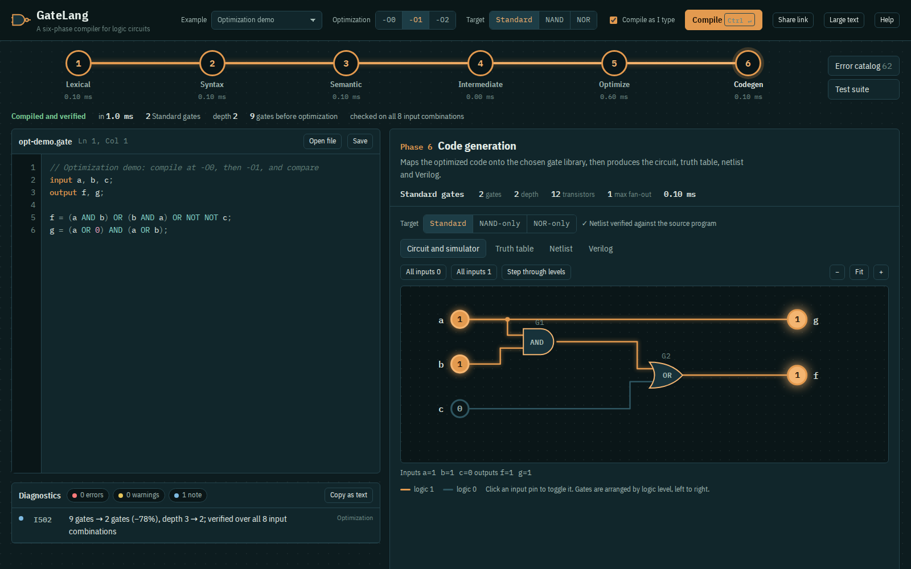
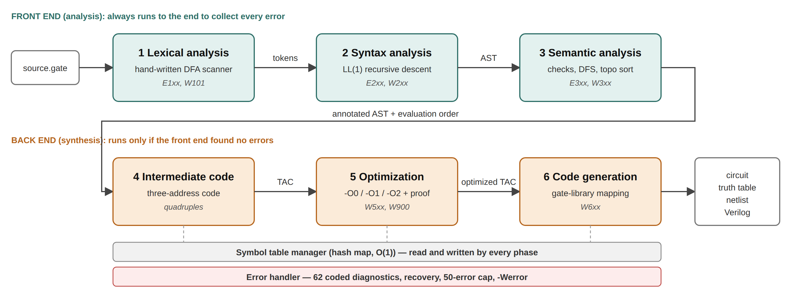

# GateLang

**A six-phase compiler that turns Boolean logic into verified gate-level circuits.**

You write a circuit as Boolean equations. GateLang runs it through all six classic compiler phases and produces a circuit diagram you can click on, a truth table, a gate-level netlist and synthesizable Verilog. It also proves that the result is correct.

```
input a, b, cin;
output sum, cout;

sum  = a XOR b XOR cin;
cout = (a AND b) OR (cin AND (a XOR b));
```



Compiler Design course project, built on the **AI Product Engineering Track** (see [below](#implementation-track-ai-product-engineering)). Everything runs in the browser, with nothing to install, and the same compiler runs from the command line under Node.js.

**Live demo:** <https://janhvi2909.github.io/gateLang/>

---

## Features

Type a program, press **Compile**, and every phase of the compiler shows its own output in a separate panel:

| Phase | What you see in the UI |
|---|---|
| 1. Lexical analysis | Token table (type, lexeme, line:column) and syntax colouring driven by the real lexer |
| 2. Syntax analysis | Abstract syntax tree and full parse tree, drawn as diagrams |
| 3. Semantic analysis | Symbol table, dependency graph, evaluation order and the list of checks that ran |
| 4. Intermediate code | Three-address code as quadruples (one instruction = one gate) |
| 5. Optimization | Before/after code, every rewrite with the Boolean law that justified it, gate-count savings and the equivalence proof |
| 6. Code generation | Clickable circuit diagram with a live simulator, truth table, gate-level netlist and Verilog for the chosen gate library |

Diagnostics from all phases are listed together, each with a code, location, caret and fix hint; the **Error catalog** tab explains all 62 codes and the **Test suite** tab runs the compiler's self-tests (catalog examples, example circuits, robustness and fuzzing) right in the browser.

### What makes it different

| | Typical student compiler | GateLang |
|---|---|---|
| Errors | Stops at the first error | Reports **every** error in one run, each with a code, line:column, a caret under the source and a fix hint ("did you mean 'sel'?") |
| Diagnostics | A handful of messages | **62 coded diagnostics** (38 errors, 21 warnings, 3 notes), each documented with a runnable example |
| Semantic checks | Undefined variable | Combinational-loop detection that prints the cycle (`x → y → z → x`), multiple drivers, undriven outputs, floating wires, unused signals |
| Optimization | None, or constant folding | Three levels: `-O0`, `-O1` (10 Boolean laws covering 34 rewrite rules, CSE, copy propagation, dead code) and `-O2` (Quine–McCluskey), **with an automatic proof of equivalence** |
| Code generation | Prints a truth table | Targets three gate libraries (standard, NAND-only, NOR-only) with peephole optimization; emits a netlist and Verilog |
| Output | Text | Live circuit simulator, virtualised truth table (up to 65,536 rows), syntax and parse trees, dependency graph |
| Testing | A few examples | 212 automated checks, 118 golden test files, and fuzzing: 10,000 random circuits × 9 configurations, and 10,000 corrupted programs |

## Results (measured; full output in [`docs/results/`](docs/results))

- **Correctness:** 10,000 random circuits were each compiled 9 ways (3 optimization levels × 3 gate libraries), giving 90,000 compilations. All were equivalent to the source program.
- **Robustness:** none of 10,000 randomly corrupted programs crashed the compiler. Edge cases such as 10,000 nested parentheses, binary garbage, BOMs and CRLF line endings are all handled.
- **Optimization:** the BCD-to-7-segment decoder drops from 314 gates to 54 (−83%), and the optimization demo from 9 gates to 2 (−78%).
- **Speed:** a full adder compiles in about 0.3 ms. The bit-parallel truth-table engine is 200 to 1,100 times faster than row-by-row evaluation, depending on the machine.

---

## Requirements and dependencies

| What | Needed for | Version |
|---|---|---|
| A modern web browser (Chrome, Edge, Firefox or Safari) | The web app (`index.html`, `dist/GateLang.html`) | Any recent version |
| [Node.js](https://nodejs.org/) | The command-line compiler, tests, benchmarks and build scripts | 16 or newer (CI uses 20) |
| Third-party packages | Nothing | **None.** The project has zero npm dependencies, so there is no `npm install` step |

The compiler is plain JavaScript with no build step. The IBM Plex fonts used by the UI are bundled in `ui/fonts/`, so the app also works offline.

## Setup

```bash
git clone https://github.com/Janhvi2909/gateLang.git
cd gateLang
node --version        # should print v16 or newer
npm test              # runs the 212 checks; nothing to install first
```

## Build and run

**In a browser, with nothing to install:** open `index.html` (double-click it), or download the single-file build `dist/GateLang.html`, which works offline and can be sent as one attachment.

**Online, via GitHub Pages:** the app is deployed at <https://janhvi2909.github.io/gateLang/>. To deploy your own copy, go to *Settings → Pages → Build and deployment → Deploy from a branch*, choose `main` and `/ (root)`, then save.

**From the command line (Node.js 16 or newer):**

```bash
node cli/gatec.js examples/full_adder.gate                  # netlist (default)
node cli/gatec.js examples/full_adder.gate -O2 --target=nand --emit=verilog
node cli/gatec.js examples/error_showcase.gate              # see every error at once
node cli/gatec.js --explain=E309                            # describe a diagnostic
npm test                                                    # 212 checks
npm run test:full                                           # with 10,000-program fuzzing
npm run bench                                               # benchmarks
npm run build                                               # rebuild dist/GateLang.html
```

`--emit` accepts `tokens`, `ast`, `symtab`, `tac`, `opt`, `netlist`, `verilog`, `table` or `all`. Other options: `-Werror`, `--no-warn=W301,W201` and `--timings`.

---

## The language

| Construct | Example |
|---|---|
| Declarations | `input a, b;` `output y;` `wire t;` |
| Assignment | `y = (a AND b) OR NOT c;` |
| Operators | `NOT` `AND` `NAND` `XOR` `XNOR` `OR` `NOR`, with symbol forms `!` `~` `&` `^` `\|` |
| Precedence | `NOT` > `AND`/`NAND` > `XOR`/`XNOR` > `OR`/`NOR`, left-associative |
| Constants | `0`, `1` |
| Comments | `// line` and `/* block */` |

Keywords are case-insensitive, names are case-sensitive, and assignments may appear in any order (the compiler works out the evaluation order). Every output must be assigned exactly once. The full reference and the LL(1) grammar are in [`docs/LANGUAGE.md`](docs/LANGUAGE.md).

## The six phases



| Phase | Module | What it does |
|---|---|---|
| 1. Lexical analysis | `src/lexer.js` | Hand-written DFA scanner with maximal munch and an O(1) keyword lookup. Illegal characters become BAD tokens, so one typo never cascades. |
| 2. Syntax analysis | `src/parser.js` | LL(1) recursive descent, one function per grammar rule. Panic-mode, phrase-level and error-production recovery. |
| 3. Semantic analysis | `src/semantic.js`, `src/symtab.js` | Symbol table (hash map) and 7 checks. Iterative three-colour DFS finds loops, and Kahn's algorithm gives the evaluation order. |
| 4. Intermediate code | `src/icg.js` | Three-address code from a post-order walk, stored as quadruples. One instruction is one gate. |
| 5. Optimization | `src/optimizer.js`, `src/qm.js`, `src/verify.js` | Fixpoint passes: copy propagation, constant folding, 10 Boolean laws (34 rewrite rules), value-numbering CSE and dead-code elimination; Quine–McCluskey at `-O2`; exhaustive equivalence proof. |
| 6. Code generation | `src/codegen.js`, `src/simulator.js` | Technology mapping to standard, NAND-only or NOR-only gates, double-inversion peephole, netlist and Verilog emission, levelisation, and bit-parallel simulation. |

The **error handler** (`src/diagnostics.js`, `src/catalog.js`) and the **symbol table** are shared by every phase, as in the textbook model. The front end (phases 1–3) always runs to the end so that every error is reported; the back end runs only when there are no errors.

## Project structure

```
index.html              web app (open directly, or serve with GitHub Pages)
dist/GateLang.html      single-file build: everything inlined, works offline
src/                    the compiler (no UI code; runs in the browser and in Node)
ui/                     editor, panels, circuit and table renderers, styles, fonts
cli/gatec.js            command-line compiler
tests/run-tests.js      test runner; tests/cases/ holds 118 golden files
tests/bench.js          benchmarks
tools/                  test generator, docs generator, single-file builder
examples/               24 example circuits (.gate)
docs/                   report, presentation script, language reference, error catalog, screenshots
```

## Documentation

- [`docs/GateLang_Project_Report.docx`](docs/GateLang_Project_Report.docx): the full project report
- [`docs/PRESENTATION_SCRIPT.md`](docs/PRESENTATION_SCRIPT.md): the 10-minute demo script
- [`docs/LANGUAGE.md`](docs/LANGUAGE.md): the language reference and grammar
- [`docs/ERROR_CATALOG.md`](docs/ERROR_CATALOG.md): all 62 diagnostics, with examples and real compiler output

## Implementation track: AI Product Engineering

GateLang was built on the course's **AI Product Engineering Track**: generative AI tools were used to assemble the compiler as one interactive application, where you type source code and see the output of every compilation phase (see [Features](#features)).

| Tool | What we used it for |
|---|---|
| Claude (Anthropic) | Writing the code of the compiler phases, the CLI and the web UI |
| ChatGPT (OpenAI) | Writing the project report, and researching edge cases the compiler should handle (which became the robustness tests and the error catalog's examples) |
| Claude Code (Anthropic) | Preparing this repository and README for submission |

**Methodology.** We fixed the language, the grammar, the token list and the error catalog first ([`GateLang_Project_Plan.md`](GateLang_Project_Plan.md), [`docs/LANGUAGE.md`](docs/LANGUAGE.md)), then built the compiler one phase at a time in pipeline order: lexer → parser → semantic analysis → intermediate code → optimizer → code generation, followed by the CLI, the web UI, the tests and the documentation. Each phase is a separate module in `src/` with no UI code, so it can be run, tested and explained on its own. The test suite (212 checks: golden files for every diagnostic and optimizer law, plus equivalence and crash fuzzing) is how we checked that the AI-generated code behaves correctly.

## Team and individual contributions

| Member | GitHub | Modules implemented | Main files |
|---|---|---|---|
| Manasa | [@manasa030606](https://github.com/manasa030606) | Lexer; parser and syntax trees; symbol table and semantic analysis | `src/tokens.js`, `src/lexer.js`, `src/ast.js`, `src/parser.js`, `src/symtab.js`, `src/semantic.js` |
| Anuj Kumar Singh | [@MUFFANUJ](https://github.com/MUFFANUJ) | Error handler and error catalog; intermediate code generation | `src/diagnostics.js`, `src/catalog.js`, `src/icg.js` |
| Vaishnav Verma | [@vermavaishnav70](https://github.com/vermavaishnav70) | Optimizer and Quine–McCluskey; code generation (netlist and Verilog) | `src/optimizer.js`, `src/qm.js`, `src/codegen.js` |
| Ronit Kumar Choudhary | [@codeit-ronit](https://github.com/codeit-ronit) | Simulator and verification; web UI; CLI | `src/simulator.js`, `src/verify.js`, `index.html`, `ui/`, `cli/gatec.js`, `tools/build.js` |
| Janhvi Yadav | [@Janhvi2909](https://github.com/Janhvi2909) | Tests and benchmarks; documentation, report and presentation | `tests/`, `src/selftest.js`, `tools/gen-tests.js`, `examples/`, `src/examples.js`, `docs/`, `tools/gen-docs.js`, `README.md` |
| Whole team | | Language design, project plan, and the compiler driver that connects the six phases | `GateLang_Project_Plan.md`, `src/compiler.js` |

## Future scope

- **Sequential logic:** flip-flops, a clock and registers, so that GateLang can describe counters and state machines, not only combinational circuits.
- **Buses and modules:** multi-bit signals (`a[3:0]`) with bitwise operators, and reusable modules that can be instantiated, for hierarchical designs such as an n-bit adder built from full adders.
- **More optimization phases:** BDD-based or Espresso-style heuristic minimisation for functions with more than 10 inputs, where exact Quine–McCluskey becomes too slow, plus multi-level factoring that shares logic between outputs.
- **More code-generation targets:** VHDL output, FPGA lookup-table (LUT) mapping, and gate libraries with area and delay costs so that technology mapping can optimise for speed or size.
- **Timing analysis:** report the critical path in nanoseconds from per-gate delays, not only the logic depth.
- **Editor tooling:** a Karnaugh-map view in the UI, and a VS Code extension that shows GateLang diagnostics while you type.

## License

MIT, see [LICENSE](LICENSE). The bundled IBM Plex fonts are under the SIL Open Font License (`ui/fonts/OFL-LICENSE.txt`).
